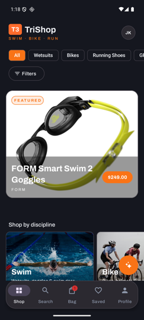
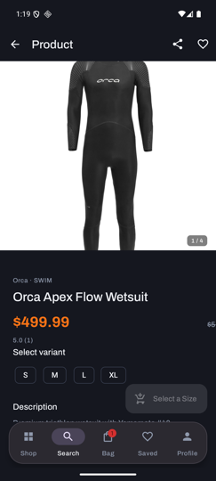
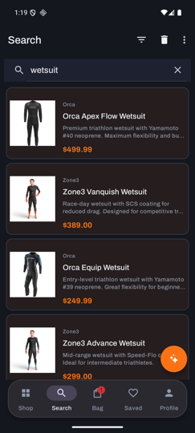
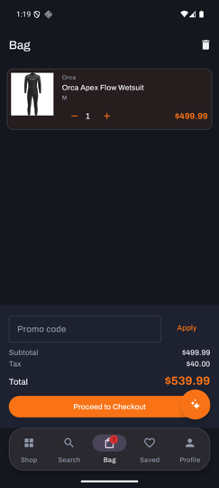
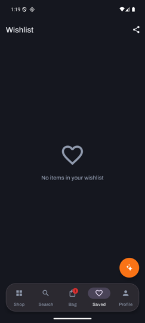
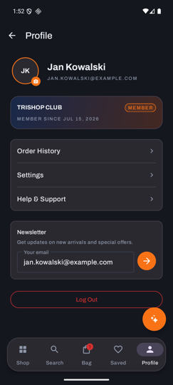
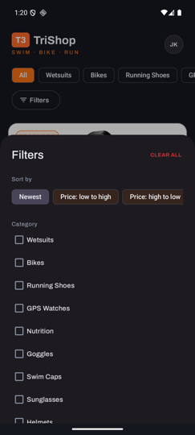
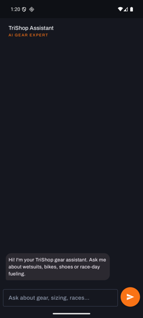

# TriShop Android (Java)

E-commerce app for triathletes — browse gear, shortlist favourites, manage a bag, check out, track orders and chat with an AI gear assistant. Pure-Java implementation of the TriShop Android client, feature-for-feature with the Kotlin and iOS apps; all of them talk to the same backend.

## Screenshots

| Shop | Product | Search | Bag |
|:---:|:---:|:---:|:---:|
|  |  |  |  |
| T3 lockup, category chips + filter panel, featured hero, *Shop by discipline* rail, floating dock | Gallery with page counter, brand·discipline kicker, rating, size chips, stock-aware CTA | Debounced server search with brand kickers and accent prices | Server-backed bag with steppers, promo box, tax breakdown and live dock badge |

| Saved | Profile | Filters | AI Assistant |
|:---:|:---:|:---:|:---:|
|  |  |  |  |
| Wishlist grid with *Add to bag* ghost buttons and long-press removal | TRISHOP CLUB card, orders/settings/help menu, newsletter signup | Web-parity panel: sort, multi-category, price buckets, backend brand list | Streaming gear expert with markdown replies and product cards (SSE) |

## What the app does

- **Shop (home)** — brand header with category chips and a filter panel, featured carousel (top-rated), "Shop by discipline" tiles (Swim / Bike / Run), a server-filtered "New arrivals" grid with a live product count, and a "Recently viewed" strip.
- **Search** — debounced server search, client-side filters (categories, price buckets, brands from the backend) and sorting, recent searches.
- **Product page** — image gallery with a page counter, rating, size picker, reviews (read + write, sign-in gated), related products, share, and stock-aware CTA states.
- **Bag** — server-backed cart with optimistic updates, quantity steppers, swipe-to-delete, promo codes, and a subtotal / discount / 8% tax breakdown.
- **Checkout** — order summary (with the shipping rule displayed: free over $100, else $9.99), a validated shipping form prefilled from your profile, and order placement.
- **Orders** — confirmation with an animated checkmark and PDF invoice sharing, order history, and a status-timeline detail view.
- **Wishlist** — server-backed two-column grid with "Add to bag", long-press removal and text sharing.
- **Profile** — avatar upload with a 5 MB cap, loyalty card, newsletter signup, Settings (System/Light/Dark theme) and Help & Support (FAQ + contact).
- **Assistant** — floating chat that streams answers (and product cards) from the TriShop AI service over SSE.
- **Auth** — login/register, JWT in `EncryptedSharedPreferences` with cookie-based refresh, biometric unlock.

## Requirements

- JDK 17
- Android SDK (API 34) — via Android Studio or command-line tools
- An emulator or device on API 26+
- The TriShop backend running locally (see below)

## Backend setup (step by step)

The debug build expects two local services. From the emulator they are reached via `10.0.2.2` (already configured — you don't need to change anything):

1. **REST API on port 9080** — start the TriShop backend. The app calls it at `http://10.0.2.2:9080/api/v1/...`.
2. **AI chat service on port 9100** *(optional)* — powers the assistant. Without it the rest of the app works; the assistant shows an error message.

Release builds point at `https://api.trishop.dev/` and `https://chat.trishop.dev/` (see `app/build.gradle.kts`).

## Build and run (step by step)

Command line:

```bash
# 1. Build the debug APK
./gradlew assembleDebug

# 2. Install it on the running emulator/device
adb install -r app/build/outputs/apk/debug/app-debug.apk

# 3. Launch it
adb shell am start -n com.trishop.app/.presentation.main.MainActivity
```

Android Studio: open the project, pick the `app` configuration and press Run.

## Tests and checks

```bash
./gradlew test            # unit tests (ViewModels, formatting, search logic)
./gradlew lint            # Android Lint (CI runs this too)
./gradlew assembleDebug   # debug build
```

CI (GitHub Actions) runs lint, unit tests and the debug build on every push and pull request to `main`.

## Project structure

```
app/src/main/java/com/trishop/app/
├── core/          # UiState, formatting/date helpers, network monitor, token storage
├── data/          # Retrofit APIs & DTOs, SSE chat client, RxDataStore stores, repository impls
├── di/            # Hilt modules
├── domain/        # models, repository interfaces, use cases
└── presentation/  # one package per screen (home, search, detail, cart, checkout, chat, …)
```

100% Java 17 + XML views (ViewBinding), MVVM with use cases, RxJava 3 + LiveData, Hilt, Retrofit/Moshi with an RxJava call adapter, Paging 3 (`RxPagingSource`), Glide, Navigation Component with Safe Args, Material 3 with the Archivo / IBM Plex Mono brand fonts.

**Min SDK 26, target SDK 34, Java 17.**
